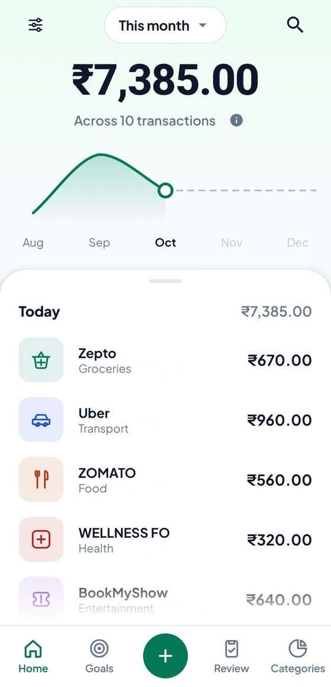
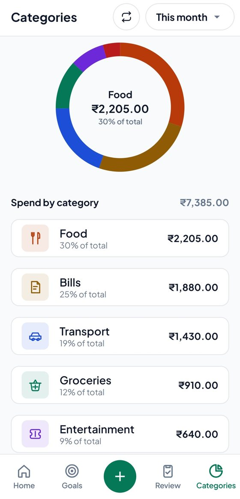
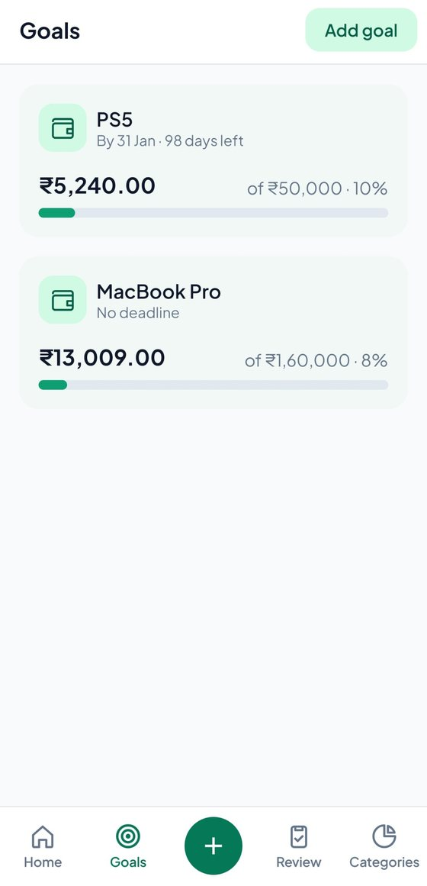
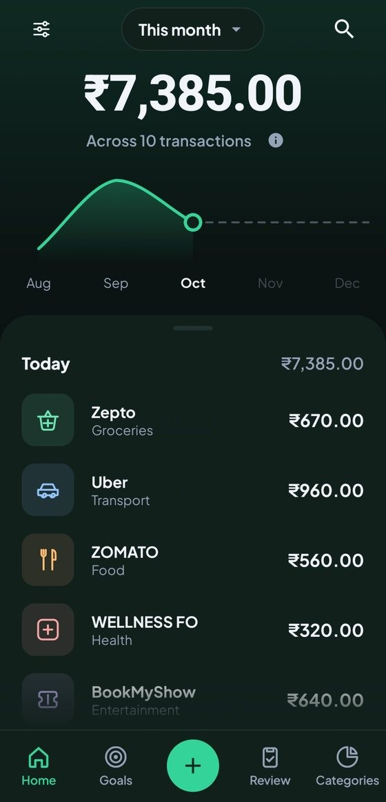

# AutoFlow

**Track your spending without typing anything, privacy first.**

AutoFlow is an Android app that reads your bank's "debited" SMS on your phone, picks out the amount and the shop, and saves it as an expense. You see where your money went, and you can set goals for what you want.

<p>
  
  
  
  
</p>

## Why it exists

Most expense apps make you type every payment, so people quit after a week. Others ask you to link a bank account, which many people don't want to do. A list of spends also doesn't show what they cost you. AutoFlow records payments by itself and ties your saving to things you actually want.

## What it does

- **Captures payments automatically.** It reads incoming bank SMS on your phone and saves the amount and shop as an expense.
- **A small notification confirms each capture.** Change the category or tap "Not an expense" from the notification, without opening the app.
- **Review tab.** Payments AutoFlow isn't sure about wait here. They already count in your total.
- **Home and Categories.** The month's total, every payment, and which category takes the biggest share.
- **Goals.** Pick something you want and track what you save towards it. Goals never touch real money.
- **Quick expense.** Add a cash spend with a number pad.
- **Home-screen widgets.** Add an expense or a saving in one tap, and see this month's total.
- **Daily recap.** A summary of the day's spending, which you can turn off in Settings.
- **Light and dark themes.**
- **Autopay (first preview).** A page for automatic payments like subscriptions.

## Privacy

- The app has **no internet access**, so your data has nowhere to go.
- No login, no ads, no tracking, and no bank account to link.
- It reads only incoming bank alerts and never saves the message text.
- The code is public, so you can check all of this yourself.

## Install

AutoFlow is installed from a file, not from the Play Store (a Google Play version is coming soon).

1. Download [`AutoFlow.apk`](landing/AutoFlow.apk) on your Android phone and open it.
2. If Android warns you about unknown apps, tap **Allow install anyway**, then **Install**.
3. If you see **"App blocked to protect your device"**, pause Play Protect scanning (Play Store → your profile → Play Protect → gear icon → turn off "Scan apps with Play Protect") and install again.
4. If you see **"SMS permission is blocked"**, open the app's settings, tap the three dots at the top right, choose **Allow restricted settings**, then come back and tap **Allow SMS access**.

Step-by-step pictures for each of these are on the project's website, in the `landing` folder of this repo.

## Build from source

AutoFlow is a Kotlin app with a Jetpack Compose interface, a Room database and WorkManager. The SMS parsing lives in the `parser-core` module.

**You need**
- JDK 21
- The Android SDK (API 35). Android Studio installs it for you.
- The Gradle wrapper is included, so you don't need to install Gradle.

**Build a debug APK** from the project folder:

```
./gradlew assembleDebug        # macOS / Linux
gradlew.bat assembleDebug      # Windows
```

The APK is created at `app/build/outputs/apk/debug/app-debug.apk`. The minimum supported Android version is 8.0 (API 26).

## Feedback

Found something confusing or broken? [Open an issue](../../issues/new). Please don't paste SMS text, OTPs or account numbers.

## Credits and license

The SMS parsing core comes from PennyWise and is used under its AGPL license. See `LICENSE` and `NOTICE` in this repo for the license terms and credits.
